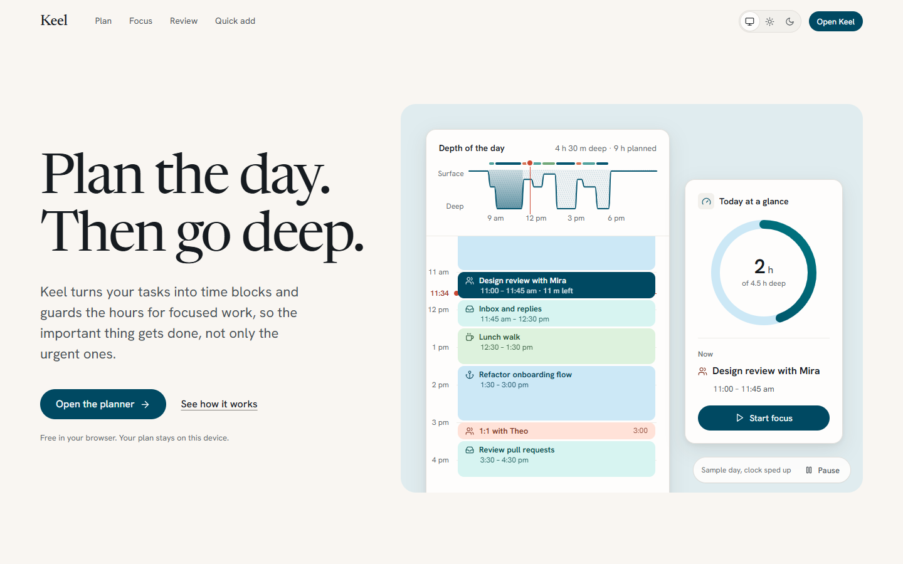
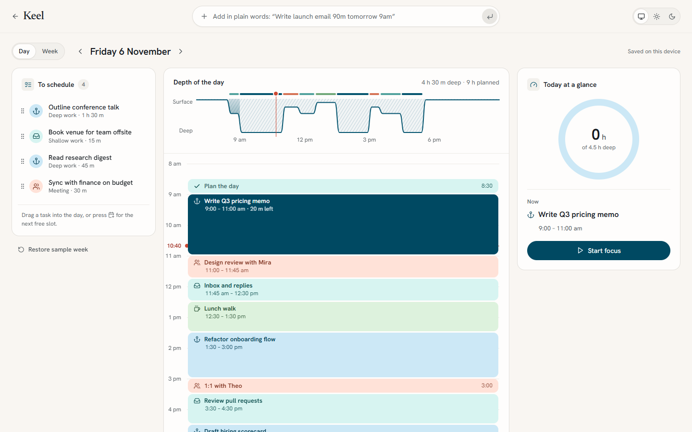
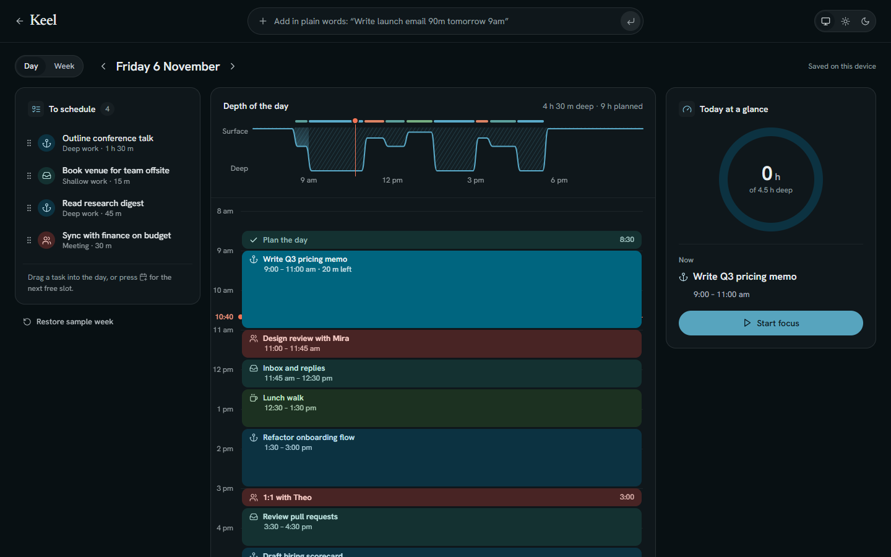
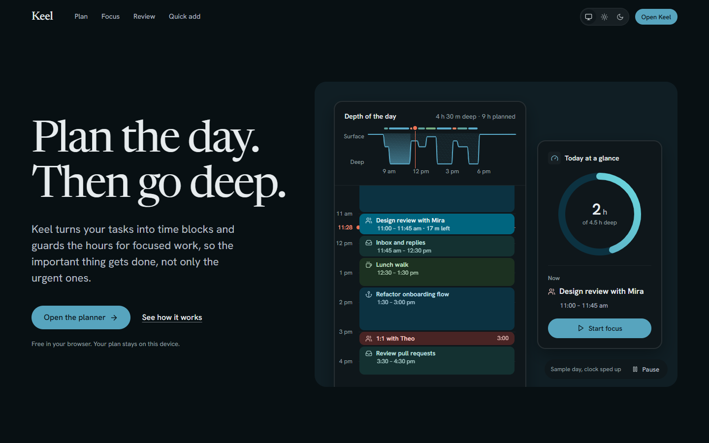
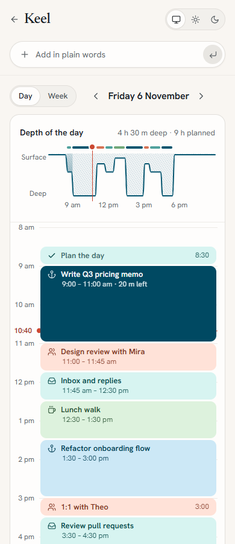

# Keel

**A focus and time-blocking planner.** Keel turns your task list into time blocks on the day, and shows how deep your
day really goes: a "depth profile" draws the hours as a sounding line that dives where focused work is planned.



## What it is

- **The planner** (`#/app`): drag a task into the day, resize and move blocks (mouse or keyboard), add tasks in plain
  words ("Write launch email 90m tomorrow 9am"), run a focus timer on the block in progress, and review the week.
  Undo for every change. Light and dark themes.
- **The product page** (`#/`): a hero showing the planner's day live, then four self-playing demos (plan the day,
  focus timer, week review, quick add), each built from the planner's real components.

## Who it's for

Knowledge workers (product, design, engineering, writing) who plan the day on a laptop in the morning and want the
hours for hard work to actually happen.

## Status

A working **prototype** (version 1, November 2026). It is not a hosted product: there are no accounts and no sync.
Known gaps, recorded in [design-notes/keel.md](design-notes/keel.md): very short blocks clip their text at 320 px with
enlarged text; the product page is slow to settle on a low-end phone; not yet tested on a real touch device, in Firefox
or with a screen reader.

## Privacy

Everything runs in your browser. Your plan is saved in the browser's local storage on your device (`keel.data.v1`);
nothing is sent to a server. The people, tasks and numbers in the sample week are invented.

## Built with

React 18, TypeScript, Vite 6, lucide-react icons. Fonts: Hanken Grotesk and Newsreader (Google Fonts). The self-playing
demos use a small demo kit of my own, vendored in `app/src/kit/`.

## Run it

```sh
cd app && npm install && npm run dev
```

Then open http://127.0.0.1:5220/ (product page) or http://127.0.0.1:5220/#/app (planner).
`npm run build` type-checks and builds to `app/dist/`. `?theme=light|dark` forces a theme; `?at=10:40` pins the time of
day (nothing is saved in that mode).

- **Single-file page:** `publish/keel-local.html` opens in a browser on its own (fonts need internet); `publish/keel.html`
  is the same page without the `<html>`/`<head>` wrapper, for embedding. To rebuild both: `npm run build` in `app/`, then
  `python -I package.py` here. `tools/snapshot.py` prerenders the first screen (`publish/first-screen.html`) from the
  built page served on port 5222.
- **Tests:** `python -I tests/flows.py [url]` drives the planner end to end in a browser (needs Python Playwright;
  the default URL is the dev server). Parser tests, from `app/`:
  `npx esbuild ../tests/parse.test.ts --bundle --platform=node --outfile=../tests/.parse.cjs && node ../tests/.parse.cjs`

## Screenshots

| | |
|---|---|
|  |  |
|  |  |

Full pages: [product page, desktop](docs/screenshots/site-1440-full.png) ·
[product page, phone](docs/screenshots/site-390-full.png)

## How it was designed

- [design-notes/direction.md](design-notes/direction.md): the concept, the five lines (product, character, world,
  moments, signature) and the direction "Deep water on paper", with the alternates that were considered.
- [design-notes/keel.md](design-notes/keel.md): assumptions, applied rules, the checks that were run, review findings
  and what is still open.

## Licence

MIT, see [LICENSE](LICENSE). Copyright (c) 2026 Ankeet Panda.

## Third-party notices

- Icons: [Lucide](https://lucide.dev) (ISC licence), via `lucide-react`; also inlined in `publish/*.html`.
- Fonts: Hanken Grotesk and Newsreader, SIL Open Font License 1.1, loaded from Google Fonts at runtime (not bundled).
- npm packages keep their own licences (React and React DOM: MIT).

Full third-party licence texts are in [licenses/](licenses/).
